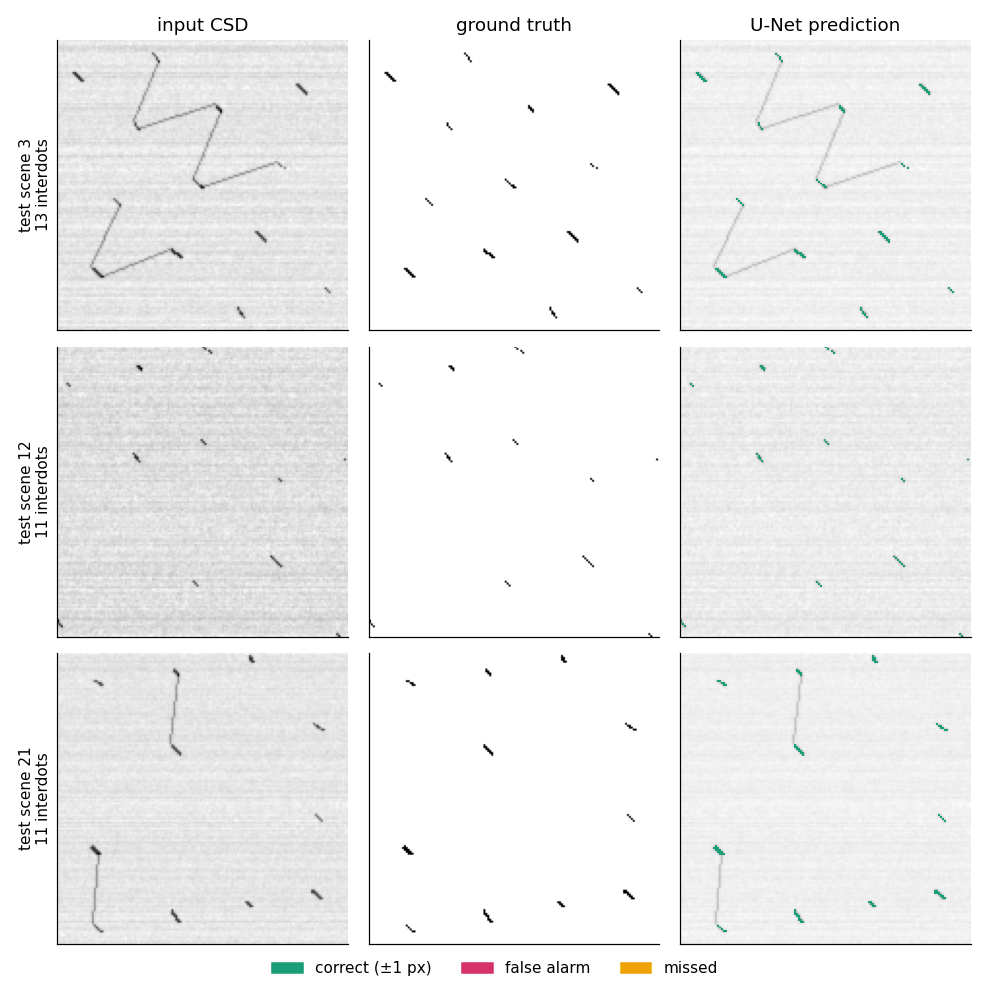
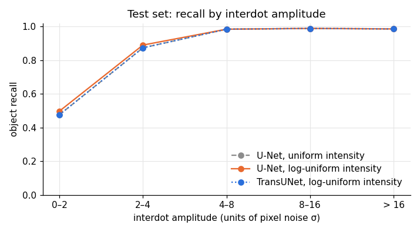
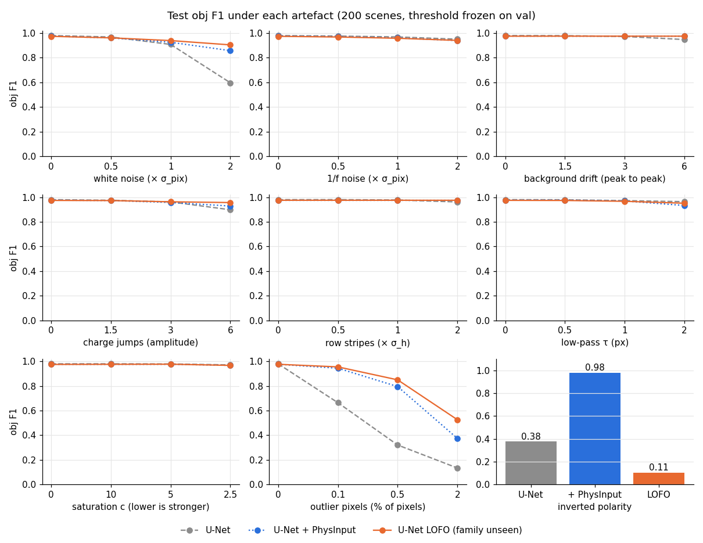

# Interdot detection with a U-Net

Detection of interdot transitions in charge stability diagrams (CSDs) of a simulated double quantum dot. This was my part of a team project at the C12 Quantum Electronics hackathon in 2026. The rest of the project covered classical baselines and gate optimization and is not included here.



**Task.** Input: a 150 × 150 CSD. Output: a binary mask of the interdot pixels. Interdots are short sticks 4 to 8 px long and under 2 px wide. They cover 0.35 % of the image.

## Results

Test set of 400 scenes from the official generator. Threshold and checkpoint are chosen on a separate validation set.

| | Logistic regression (team baseline) | U-Net | U-Net LOFO |
|---|---|---|---|
| object F1, test | 0.924 | **0.979** | 0.975 |
| object F1, frames of the optimization task | 0.62 | **0.96** | 0.95 |
| robustness score, 25 perturbed sets | **0.935** | 0.872 | 0.930 |
| false alarms per empty scene | **0.28** | 0.78 | 1.10 |
| parameters | 4 | 1.9 M | 1.9 M |

- **Object F1** counts an interdot as found if a predicted pixel lies within half its length of its centre. I used it instead of Dice because the official mask is fragmented and its width depends on pixelization.
- **Robustness score** is the mean over 25 perturbed test sets of object F1 (perturbed) / object F1 (clean). 1 means insensitive.
- **U-Net LOFO** is the final recipe. Each perturbed set is scored by a model that never saw that artefact family in training.

## Method

### 1. Training on an infinite generator

Blur is linear in the simulator. A scene is therefore `intensity · template + blur(noise)`. I precompute 30,000 noise-free geometries once and redraw intensity and noise on the GPU at every batch. No image is seen twice. A dedicated check confirms that the synthetic noise matches the official one (pixel std, row stripes, autocorrelations).

The network learns the soft label with a BCE + Dice loss. Augmentations are restricted to the exact symmetries of the device (transpose, 180° rotation, anti-transpose). A plain flip would turn a +45° interdot into a −45° one, which is a different device.

Drawing the intensity log-uniformly instead of uniformly puts 40 % of training scenes below 4σ. That is the regime where the downstream optimizer spends most of its time. Between 2σ and 4σ recall goes from 0.37 for logistic regression to 0.89 for the U-Net.



A TransUNet (5.9 M parameters, global attention) trained with the same recipe scores the same as the U-Net. The extra capacity brings nothing measurable here, so I kept the U-Net.

### 2. Robustness to lab artefacts

The simulator produces only white noise and row stripes. Real measurements contain other artefacts, so I built a suite of 9 artefact families at 3 severity levels each: white noise, 1/f noise, background drift, charge jumps, row stripes, low-pass filtering, saturation, outlier pixels and inverted polarity.

On clean data the plain U-Net is more accurate than the baselines. On artefacts it was not trained on it degrades much faster: 0.1 % of outlier pixels lowers its object F1 from 0.98 to 0.66. I made two changes and kept the same architecture.

- **PhysInput**: a parameter-free input layer that subtracts the row median, normalizes by the MAD and removes isolated outlier pixels.
- **Randomized generator**: the 8 non-polarity families are drawn on the GPU during training, each with probability 0.2.

### 3. Leave-one-family-out

Training on all families and testing on the same families only measures how well the suite was learned. To test against an artefact nobody planned, I trained one model per family with that family removed from training and scored it only on that family. This makes 22 runs (11 per model size, at 0.5 M and 1.9 M parameters).



PhysInput with polarity augmentation alone raises the robustness score from 0.872 to 0.95. Adding the other families to training helps much less: an unseen family gains under 0.02 object F1 from the families that were seen. Two families cannot be handled without training on them. With polarity held out, object F1 drops to 0.1. With outlier pixels held out, it drops to 0.53 at the strongest level. The 0.5 M and 1.9 M models give the same scores.

For a real device this means known invariances such as polarity should be built into the input or the augmentations. Every plausible artefact should be simulated during training. A simple detector should remain available as a fallback when the input statistics differ from the training data.

Full per-family table: [`results/lofo/lofo.md`](results/lofo/lofo.md).

## Limits

- One seed per run. Differences around 0.005 are within noise. The drops on polarity and outlier pixels are far larger than that.
- Everything is synthetic. Only lab data can tell whether the artefact suite covers a real chip.
- The U-Net raises more false alarms on empty scenes than the classical baselines. Its threshold should be recalibrated on that rate before driving an optimizer.

## Usage

```bash
uv sync
uv run python figures/make_figures.py        # CPU, about a minute
```

```python
from detection.export_dl import load, predict_mask
model, thr = load("models/unet_lowsnr.pt")
masks = predict_mask(model, thr, images)      # images: (N, H, W) raw CSDs
```

Training and evaluation need a GPU.

```bash
uv run python -m detection.data_gen pool --n 30000 --out data/pool --workers 32
uv run python -m detection.data_gen sets --out data/eval --workers 32
uv run python -m detection.data_gen verify --pool data/pool --eval data/eval
uv run python -m detection.train --arch unet --seed 0 --steps 14000 --warmup 300 --eval-every 1000 --compile --intensity-law loguniform --out runs/unet_lowsnr
uv run python -m detection.robustness unpack                 # rebuilds the 25 perturbed sets
uv run python -m detection.lofo jobs                         # one line per run, for detection/lofo_job.sh
uv run python -m detection.lofo report
```

To score any detector on the artefact suite, see [`robustness_suite/README.md`](robustness_suite/README.md).

## Layout

| path | content |
|---|---|
| `detection/` | data generation, model, training, evaluation, robustness suite, LOFO protocol |
| `models/` | exported U-Net and TransUNet (float16 weights with their threshold) |
| `robustness_suite/` | clean test and val sets; the 25 perturbed sets regenerate bit for bit |
| `results/` | raw evaluation tables and per-run logs |
| `simulator/` | CSD generator provided by the hackathon organizers ([C12 Quantum Electronics](https://www.c12qe.com)) |
